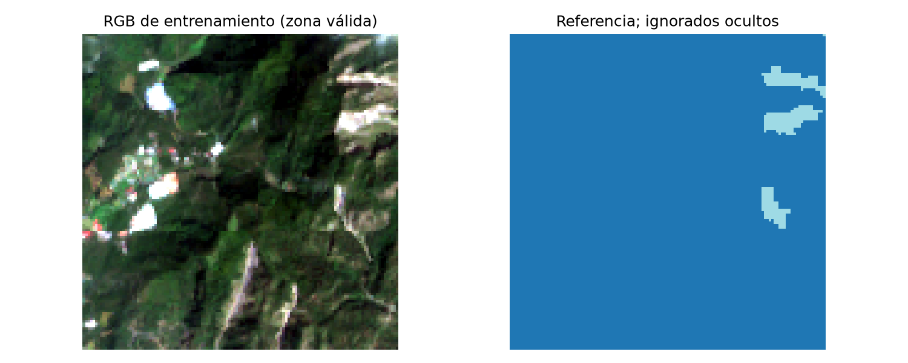
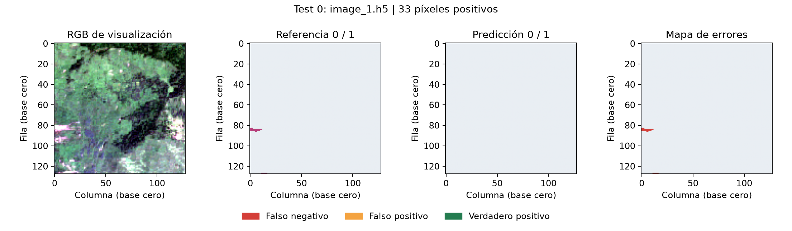
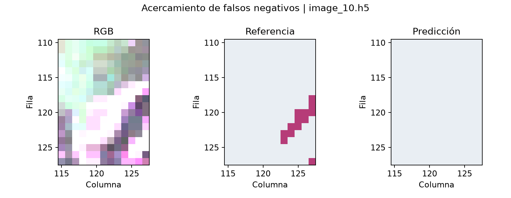
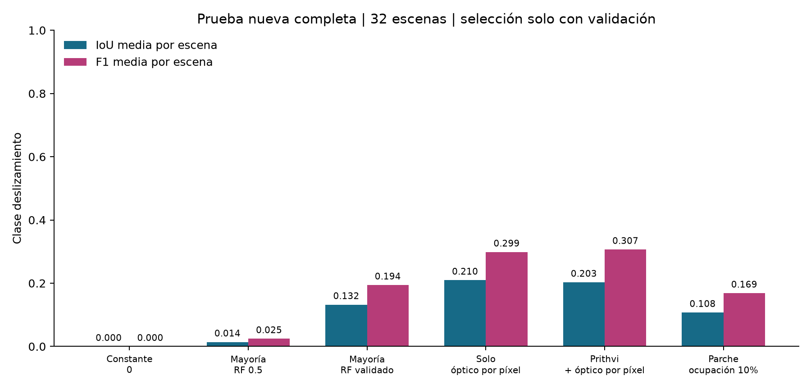
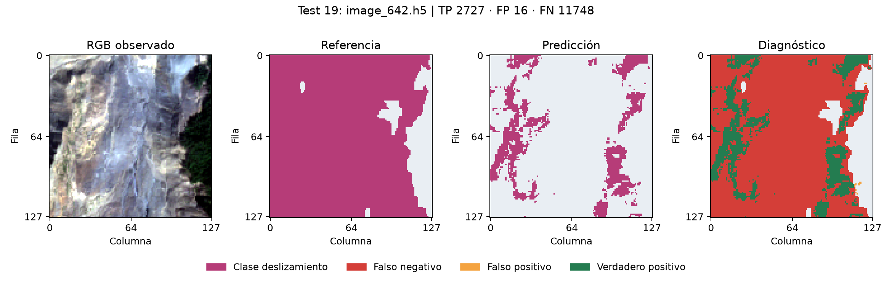
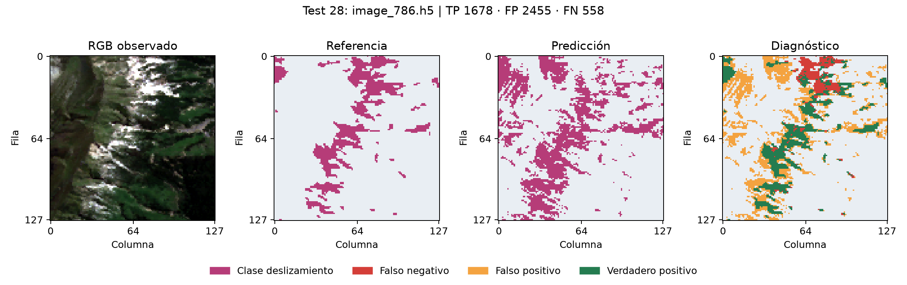
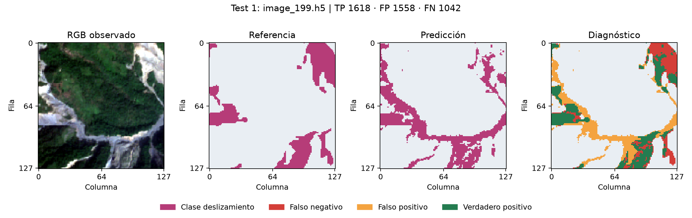

# Detección de deslizamientos con Prithvi

**Grupo 2 · Inteligencia Artificial**  
**Profesor:** Eduardo Enrique Zurek Varela  
**Entrega:** 23 de noviembre de 2026  
**Ejecución y revisión:** 17 de noviembre de 2026  
**Repositorio:** https://github.com/Charlsz/prithvi-deslizamiento

## Resumen

Evaluamos el flujo docente de segmentación binaria con Prithvi EO 1.0 100M congelado y Random Forest por parches, sobre cuatro imágenes de entrenamiento y dos de prueba de Landslide4Sense. El modelo y la línea base constante obtuvieron IoU y F1 de deslizamiento iguales a cero. El diagnóstico identificó 919 píxeles positivos en entrenamiento, pero ningún parche etiquetado como positivo tras la agregación mayoritaria. El experimento documenta una limitación del flujo ante objetos pequeños; no permite concluir que Prithvi carezca de capacidad para detectar deslizamientos. La confirmación docente del contrato de entrada sigue pendiente.

La ampliación complementaria de la sección 12 incorpora entrenamiento y validación separados y obtiene resultados distintos de cero sobre 32 escenas nuevas. Su mejor F1 medio entre las variantes con Prithvi seleccionadas en validación es 0.3068; se mantiene la distinción entre el flujo docente y las extensiones.

## 1 Contribuciones y uso de IA

Los nueve integrantes desarrollaron el proyecto de manera colaborativa, según la declaración del grupo. La contribución declarada es compartida; no se atribuyen funciones individuales que no hayan sido confirmadas.

| Integrante | Contribución declarada |
| --- | --- |
| Bauz Villa, Juan | Trabajo colaborativo en el desarrollo del proyecto |
| Cera Moran, Daniel | Trabajo colaborativo en el desarrollo del proyecto |
| Galvis Pajaro, Carlos | Trabajo colaborativo en el desarrollo del proyecto |
| Jimenez Atencia, Cher | Trabajo colaborativo en el desarrollo del proyecto |
| Mercado Martinez, Sebastian | Trabajo colaborativo en el desarrollo del proyecto |
| Molina Vega, Dayana | Trabajo colaborativo en el desarrollo del proyecto |
| Romero Pemberthy, Juan | Trabajo colaborativo en el desarrollo del proyecto |
| Ruiz Espitia, Kevin | Trabajo colaborativo en el desarrollo del proyecto |
| Vargas Becerra, Natalia | Trabajo colaborativo en el desarrollo del proyecto |

Se utilizó asistencia de IA para revisión del código, depuración, organización de entregables, verificación y redacción. Las cifras proceden de archivos y ejecución reales. Cada integrante debe poder explicar el proceso y el resultado, de acuerdo con el enunciado.

## 2 Problema y objetivo

La entrada es una imagen multiespectral; la salida, una máscara binaria que distingue fondo (0) y deslizamiento observado (1). El objetivo es medir si las representaciones de un encoder geoespacial congelado, con una cabeza ligera, superan una predicción constante. La hipótesis no se sostiene en este piloto. Detectar áreas ya afectadas es distinto de estimar susceptibilidad del terreno o predecir cuándo ocurrirá un evento.

**Hipótesis:** las representaciones del encoder Prithvi congelado, combinadas con un Random Forest por parche entrenado con el subconjunto asignado, obtienen un IoU y un F1 de la clase deslizamiento superiores a los de la línea base constante derivada del entrenamiento, evaluados sobre las mismas posiciones válidas de prueba.

## 3 Marco teórico

Un modelo fundacional aprende representaciones reutilizables mediante preentrenamiento a gran escala. Prithvi 1.0 emplea un transformer y un objetivo autosupervisado de autoencoder enmascarado, MAE [1], [2]. La imagen se convierte en tokens de parches; la atención relaciona sus características. El preentrenamiento reconstruye regiones ocultas, pero no proporciona por sí solo etiquetas de deslizamiento. Una cabeza de predicción debe aprender esa correspondencia con referencias de la tarea.

Las bandas multiespectrales describen respuestas distintas de la superficie. Su orden y escala forman parte del contrato de entrada y no son intercambiables. La transferencia reutiliza el encoder; el fine-tuning actualizaría sus pesos. Aquí todos los pesos de Prithvi están congelados y solo se entrena un Random Forest. La inferencia aplica el modelo ya configurado a una imagen. No se usa la reconstrucción del MAE como máscara de segmentación.

Utilizamos Prithvi EO 1.0 100M, no Prithvi 2.0. El artículo de la segunda versión es lectura contextual [5], no la identificación de los pesos ejecutados. La codificación posicional fija se regenera para una fecha y se comprueba que solo falten esas claves al cargar el checkpoint.

## 4 Datos y contrato de entrada

La descarga usa el espejo sasmit545/Landslide4sense de Hugging Face [4], con revisión fija 8508a55feceb5653a085d6be64ef9217710f7c00. El conjunto de origen combina canales de Sentinel 2 con pendiente y elevación de ALOS PALSAR; su documentación describe recortes de 128 por 128 píxeles a aproximadamente 10 m [3]. Los HDF5 examinados no tienen atributos de fecha, CRS, transformación geográfica o evento. Por tanto, no se asignan fechas ni regiones específicas a estas seis imágenes.

El lector suministrado selecciona índices base cero [1, 2, 3, 8, 10, 11] y excluye los dos canales auxiliares. No se da por comprobado que el índice 8 sea B8A: la descripción pública enumera 12 canales ópticos sin resolver inequívocamente esa correspondencia. Se conserva el flujo docente y se declara pendiente su confirmación sobre bandas, escala, normalización y pesos, exigida por la ficha. No se aplica una conversión inventada a reflectancia física.

La normalización es z score por banda, calculada exclusivamente sobre posiciones válidas de entrenamiento. Sus medias y desviaciones se guardan en normalizacion.json. Este ajuste no equivale necesariamente al preprocesamiento de HLS utilizado en el preentrenamiento. La visualización RGB usa rojo, verde y azul del lector y un estiramiento entre percentiles 2 y 98 solo para mostrar la imagen; no cambia la entrada del modelo.

| Partición | Archivo de imagen | Píxeles válidos | Deslizamiento |
| --- | --- | ---: | ---: |
| Train | image_1.h5 | 16384 | 405 |
| Train | image_10.h5 | 16384 | 0 |
| Train | image_100.h5 | 16384 | 479 |
| Train | image_1000.h5 | 16384 | 35 |
| Test | image_1.h5 | 16384 | 33 |
| Test | image_10.h5 | 16384 | 13 |

Se eligen los primeros archivos por orden lexicográfico en cada partición, conservando el piloto 4/2 del notebook. Los mismos nombres en train y test no significan el mismo archivo: sus SHA256 difieren. No hay imágenes idénticas por hash entre particiones, pero esto no acredita independencia geográfica o por evento. No se usa una partición de validación ni se buscan hiperparámetros.

Cada imagen produce un tensor de 6 canales y una fecha. El relleno edge completa 128 a 224 píxeles sin interpolar etiquetas. La referencia vale -1 en el relleno y en posiciones inválidas. Por escena se ignoran 33792 posiciones y se evalúan 16384. La ausencia de datos no se considera fondo. El contexto artificial del relleno puede afectar al encoder aunque no se puntúe.

## 5 Implementación y protocolo experimental

Se cargan los pesos Prithvi_100M.pt de la revisión 7b231fe5b0684e2ddd40c967fbc02e225ef77dc6 del repositorio oficial [2]. La ejecución local utiliza CPU. El cuaderno registra versiones, revisión, dispositivo y configuración; el script conserva la misma ruta. Se corrigió la lectura del YAML plano para obtener seis canales de entrada y se fijó también la revisión del dataset.

El encoder recibe 224 por 224 píxeles, produce una cuadrícula de 14 por 14 tokens de 768 componentes y recupera el orden espacial de los tokens del MAE. Cada token corresponde a un parche de 16 por 16. La etiqueta de entrenamiento es la clase mayoritaria de sus píxeles válidos, si al menos el 50 por ciento del parche es válido. En un empate de clases, np.argmax selecciona la primera clase, 0: el empate no produce un positivo.

La cabeza es un Random Forest con 80 árboles, profundidad máxima 10, ponderación balanced y semilla 42. Sus decisiones se mantienen como en el flujo revisado y no se seleccionan usando test. La predicción de cada parche se repite sobre sus 256 píxeles. La línea base predice siempre 0 porque en entrenamiento hay 64617 píxeles de fondo frente a 919 positivos, equivalentes a 98.598 y 1.402 por ciento.

El entrenamiento contiene 256 parches válidos y todos se etiquetan como fondo. La mayor fracción positiva observada es 0.3984375, inferior a la mayoría necesaria. La ponderación de clases no puede recuperar una clase que no está presente en los objetivos. La distribución completa por parche se conserva en diagnostico_parches.csv.

## 6 Evaluación cuantitativa

La agregación principal es la media aritmética por escena, como exige el enunciado. La agregación global por píxeles se presenta por separado. Para cada clase se calcula IoU = TP / (TP + FP + FN), F1 = 2TP / (2TP + FP + FN), precisión = TP / (TP + FP) y recall = TP / (TP + FN). Ambos métodos utilizan exactamente la misma máscara de posiciones válidas.

Cuando la unión es cero, IoU y F1 son NaN y esa escena se excluye de la media de esa métrica; se informa el número de escenas definidas. El recall es NaN si no hay referencia positiva. Si hay referencia positiva pero no predicciones positivas, la precisión se reporta como 0 por convención del módulo docente. Si no hay referencia ni predicción de la clase, la precisión es NaN. Aquí las dos escenas tienen positivos y las cuatro métricas están definidas para ambas.

| Método | IoU media por escena | F1 media por escena | Precisión media | Recall medio | Escenas |
| --- | ---: | ---: | ---: | ---: | ---: |
| Prithvi y RF | 0.000 | 0.000 | 0.000 | 0.000 | 2 |
| Línea base clase 0 | 0.000 | 0.000 | 0.000 | 0.000 | 2 |

Los resultados globales de la clase positiva también son 0 para ambos métodos. La prueba contiene 32722 píxeles de fondo y 46 positivos, 0.1404 por ciento del total. La exactitud global es 99.8596 por ciento pese a que no se detecta ningún positivo; por eso no es la métrica principal.

| Método y clase | Soporte global | IoU global | F1 global | Precisión global | Recall global |
| --- | ---: | ---: | ---: | ---: | ---: |
| Prithvi y RF fondo | 32722 | 0.998596 | 0.999298 | 0.998596 | 1.000000 |
| Prithvi y RF deslizamiento | 46 | 0.000000 | 0.000000 | 0.000000 | 0.000000 |
| Línea base fondo | 32722 | 0.998596 | 0.999298 | 0.998596 | 1.000000 |
| Línea base deslizamiento | 46 | 0.000000 | 0.000000 | 0.000000 | 0.000000 |

La matriz global es idéntica para ambos métodos: filas = referencia, columnas = predicción.

| Referencia | Predicho fondo | Predicho deslizamiento |
| --- | ---: | ---: |
| Fondo | 32722 | 0 |
| Deslizamiento | 46 | 0 |

El CSV metricas.csv corresponde a agregación global; metricas_media_por_escena.csv es la tabla principal. metricas_por_escena.csv y metricas_por_clase.csv permiten reconstruir ambas. Las predicciones y las máscaras se conservan en escena_0.npz y escena_1.npz.

## 7 Figuras y análisis de errores

Las figuras usan los datos reales, igual extensión espacial y leyenda explícita. Las imágenes tienen solo 128 por 128 píxeles: exportar a mayor resolución mejora textos y contornos, pero no añade detalle satelital. Se conserva el RGB observado sin generar texturas ni modificar etiquetas. Los paneles completos muestran la extensión válida; los acercamientos conservan índices de fila y columna.

| Caso | Muestra | Evidencia y ubicación base cero |
| --- | --- | --- |
| Acierto de fondo | Test image_1.h5 | 16351 TN; ejemplo fila 63 columna 111 |
| Falso negativo | Test image_1.h5 | 33 FN; ejemplo fila 85 columna 1; caja de positivos filas 83 a 127 y columnas 0 a 16 |
| Falso negativo | Test image_10.h5 | 13 FN; ejemplo fila 121 columna 126; caja de positivos filas 118 a 127 y columnas 123 a 127 |

No existen falsos positivos ni verdaderos positivos en estas dos escenas. Se analizan dos omisiones distintas y un acierto de fondo, de acuerdo con la excepción del enunciado para categorías inexistentes. No se presentan como aciertos de detección los verdaderos negativos.

El fallo comprobado está en la generación de objetivos de la cabeza: la mayoría por parche elimina la clase rara. Los objetos pequeños y los bordes quedan además limitados por la salida constante de cada parche. No puede atribuirse este resultado exclusivamente al encoder ni inferirse su rendimiento con una cabeza que sí haya visto positivos.

Una carretera, cantera u obra puede parecerse a una cicatriz por el suelo expuesto, el contraste y la geometría. Sombras, vegetación y nubes pueden ocultar rasgos. Estos son factores a investigar, no errores semánticos demostrados aquí: el clasificador constante no permite identificar confusiones específicas con carreteras o canteras. Sin inventario geográfico o validación experta tampoco se cuantifica la calidad de las etiquetas ni el desplazamiento regional.

## 8 Transferencia a Colombia

Proponemos estudiar una región montañosa de Antioquia con inventarios locales fechados y revisados por expertos, imágenes Sentinel 2 compatibles y máscaras por evento. Se necesitarían fechas de adquisición, CRS, resolución, nubosidad y cobertura espacial, además de pendiente y elevación. Una imagen anterior permitiría distinguir cambios recientes de suelo ya descubierto. Este planteamiento no se ejecutó con datos colombianos.

La primera adaptación sería asegurar bandas y escala compatibles. La topografía se incorporaría mediante una rama auxiliar o una arquitectura expresamente ajustada; no se introduciría como si fuese una banda óptica. Para preservar objetos pequeños se evaluaría una cabeza de segmentación de mayor resolución o una regla alternativa de objetivos, previa autorización del docente para cambiar el flujo.

La partición debe separar regiones y eventos completos, con margen espacial cuando proceda. Entrenamiento y validación servirían para ajustar hiperparámetros y umbrales; una prueba independiente se reservaría hasta cerrar el método. Se medirían IoU, F1, precisión y recall por evento, soporte y desempeño según tamaño del deslizamiento. El criterio de éxito sería superar la línea base en prueba, con recall útil y precisión revisada por expertos. Los umbrales operativos se acordarían según el costo de omisiones y falsas alarmas, sin inventar un umbral universal.

## 9 Consideraciones éticas y limitaciones

Un falso negativo puede ocultar daño y un falso positivo puede desviar recursos. La revisión experta y la validación regional son necesarias antes de cualquier decisión. No se presenta el piloto como mapa oficial, producto operativo, alerta temprana ni predicción de eventos.

El tamaño 4/2, la prevalencia positiva extrema, el relleno artificial, la resolución por parche y la falta de metadatos limitan las conclusiones. No se puede demostrar independencia por evento solo por conservar las carpetas del espejo. El contrato de canales y escala sigue sin confirmación docente. La disponibilidad pública del espejo no demuestra autorización irrestricta para redistribuir los datos: se enlazan las fuentes y se excluyen pesos y escenas crudas del paquete de entrega.

Se deben respetar licencias de código, datos y pesos. La referencia comunitaria srivassid/prithvi-landslide suministrada en la ficha no se utilizó como checkpoint ni se presenta como modelo oficial IBM NASA. Según su ficha pública, srivassid/prithvi-landslide es un ajuste fino de Prithvi-EO-2.0-300M (TL) realizado con TerraTorch para segmentación binaria sobre Landslide4Sense [9]. Su arquitectura, su número de parámetros y su forma de adaptación (fine-tuning con decoder) difieren de las de este trabajo, que usa Prithvi-EO-1.0-100M congelado con Random Forest. Por ello sus cifras no son comparables con las nuestras. El grupo no verificó su licencia, sus canales de entrada exactos ni su normalización. Las limitaciones de este piloto no pueden ocultarse mediante una selección favorable de escenas, ajustes sobre test o embellecimiento de las imágenes.

## 10 Conclusiones del piloto

El flujo se ejecuta y evalúa sobre las mismas posiciones válidas para el modelo y la línea base. Ambos obtienen IoU y F1 de deslizamiento iguales a 0, tanto por escena como globalmente. La exactitud alta del fondo no demuestra éxito en la aplicación.

El diagnóstico muestra que los 919 píxeles positivos de entrenamiento desaparecen como clase de parche: los 256 objetivos son fondo. Esta es una explicación verificable de las 46 omisiones de prueba. El estudio no prueba ni descarta la capacidad de Prithvi con una adaptación adecuada.

El piloto motivó ampliar el entrenamiento, separar validación y estudiar otras cabezas. La sección 12 presenta esa ampliación ejecutada y sus límites. El resultado negativo original se conserva como evidencia del flujo suministrado; la ampliación no acredita todavía desempeño alto ni sustituye la confirmación docente del contrato de entrada.

## 11 Referencias en formato IEEE

[1] J. Jakubik et al., “Foundation Models for Generalist Geospatial Artificial Intelligence,” arXiv:2310.18660, 2023. Disponible: https://arxiv.org/abs/2310.18660

[2] IBM NASA Geospatial, “Prithvi EO 1.0 100M,” repositorio de modelo, revisión 7b231fe5b0684e2ddd40c967fbc02e225ef77dc6. Disponible: https://huggingface.co/ibm-nasa-geospatial/Prithvi-EO-1.0-100M

[3] O. Ghorbanzadeh et al., “Landslide4Sense: Reference Benchmark Data and Deep Learning Models for Landslide Detection,” IEEE Transactions on Geoscience and Remote Sensing, vol. 60, pp. 1-17, 2022, doi: 10.1109/TGRS.2022.3215209. Disponible: https://arxiv.org/abs/2206.00515. Documentación del conjunto: https://github.com/iarai/Landslide4Sense-2022

[4] sasmit545, “Landslide4sense,” Hugging Face Datasets, espejo de datos, revisión 8508a55feceb5653a085d6be64ef9217710f7c00. Disponible: https://huggingface.co/datasets/sasmit545/Landslide4sense

[5] D. Szwarcman et al., “Prithvi EO 2.0: A Versatile Multi Temporal Foundation Model for Earth Observation Applications,” arXiv:2412.02732, 2024. Disponible: https://arxiv.org/abs/2412.02732

[6] NASA IMPACT, “HLS Foundation Models,” repositorio de código. Disponible: https://github.com/NASA-IMPACT/hls-foundation-os

[7] E. E. Zurek Varela, “Enunciado general Prithvi aplicado a problemas geoespaciales,” “Grupo 2 detección de deslizamientos” y notebook guía del Grupo 2, material docente, Inteligencia Artificial, 2026.

[8] scikit-learn developers, “Tuning the decision threshold for class prediction,” documentación oficial, consultada el 17 de noviembre de 2026. Disponible: https://scikit-learn.org/stable/modules/classification_threshold.html

[9] srivassid, “prithvi-landslide,” Hugging Face, ficha del modelo (implementación comunitaria, no oficial de IBM–NASA). Disponible: https://huggingface.co/srivassid/prithvi-landslide. Consultado el 18 de noviembre de 2026.

Fuentes web consultadas el 17 y el 18 de noviembre de 2026. Las fuentes [1] y [3] son publicaciones primarias; [2] identifica el modelo realmente utilizado. Los archivos manifest_datos.json, procedencia.json e inventario_muestras.csv conservan la trazabilidad de esta ejecución.

## 12 Ampliación experimental para superar el piloto constante

Se ejecutó una ampliación complementaria el 17 de noviembre de 2026, conservando el piloto original como evidencia del flujo suministrado. La selección de archivos se fijó antes de leer sus etiquetas: 96 escenas de train, 24 de validación y 32 de test, con semilla 20261117 y la misma revisión del espejo. Se excluyeron las seis escenas previamente utilizadas. Las particiones proceden del proveedor y no contienen imágenes idénticas por SHA256 entre sí; no se acredita independencia por evento o región porque faltan metadatos.

### Método y selección sin usar test

Se mantuvieron el encoder Prithvi congelado, los seis índices de canal del lector y la normalización estimada exclusivamente con entrenamiento. La ampliación contiene 40699 píxeles positivos y 1532165 de fondo. Con la regla mayoritaria original se obtienen 70 parches positivos y 6074 negativos, en lugar de cero positivos. El RF conserva 80 árboles, profundidad 10, ponderación balanced y semilla 42. El umbral 0.1 fue elegido en validación; el umbral estándar 0.5 también se reporta.

Antes de abrir test se compararon tres reglas exploratorias de ocupación positiva por parche, mayores que 5, 10 y 20 por ciento, y una cabeza por píxel. La variante por parche elegida en validación fue ocupación mayor que 10 por ciento con umbral 0.55. Las reglas de ocupación no son la regla mayoritaria de la guía y se identifican como modificaciones experimentales.

La cabeza por píxel utiliza seis bandas normalizadas y 32 componentes PCA de los embeddings de Prithvi. El PCA se ajusta solo sobre tokens válidos de train. Se interpolan características continuas para llevarlas a la cuadrícula de píxeles; las etiquetas categóricas no se interpolan. Se toman hasta 512 píxeles reales de cada clase por escena de entrenamiento, sin reemplazo y con semilla 42: 66306 en total. Un RF de 100 árboles y profundidad 20 aprende esa cabeza. Su umbral 0.55 se selecciona en validación. Como control se entrena una cabeza equivalente con solo las seis bandas ópticas, cuyo umbral de validación es 0.75.

El F1 medio de validación fue 0.1968 para el RF mayoritario validado, 0.2496 para la ocupación 10%, 0.3371 para la cabeza Prithvi y óptico por píxel, y 0.2689 para el control óptico. La variante con Prithvi elegida por F1 de validación fue la cabeza por píxel. Se guardaron configuraciones y sus hashes antes de evaluar test. No se volvió a ajustar después de abrirlo. Seleccionar umbrales en un conjunto separado evita confundir ajuste y evaluación [8].

### Resultados sobre las mismas 32 escenas nuevas

| Método | IoU media | F1 media | IoU global | F1 global | Escenas F1 definidas |
| --- | ---: | ---: | ---: | ---: | ---: |
| Línea base constante 0 | 0.0000 | 0.0000 | 0.0000 | 0.0000 | 26 |
| Prithvi RF mayoritario 0.5 | 0.0141 | 0.0246 | 0.1123 | 0.2018 | 28 |
| Prithvi RF mayoritario validado | 0.1323 | 0.1944 | 0.3714 | 0.5417 | 30 |
| Prithvi RF ocupación 10% | 0.1075 | 0.1687 | 0.2839 | 0.4422 | 29 |
| Prithvi y óptico por píxel | 0.2030 | 0.3068 | 0.2422 | 0.3900 | 31 |
| Solo óptico por píxel | 0.2098 | 0.2986 | 0.4533 | 0.6238 | 32 |

La prueba contiene 524288 posiciones válidas, de las cuales 26089 son deslizamiento y 498199 son fondo. Hay 26 escenas con referencia positiva y seis sin positivos. La media por escena sigue siendo la agregación principal. Cuando una escena no tiene referencia ni predicción positiva, su IoU y F1 son indefinidos y se excluyen; si sí hay falsos positivos, sus IoU y F1 son 0. Por eso el número de escenas definidas varía entre métodos y se muestra explícitamente. Los CSV conservan también precisión, recall y soporte por clase y escena.

La cabeza por píxel con Prithvi mejora el F1 medio frente al RF mayoritario validado, pero su IoU global y F1 global son inferiores. El control óptico obtiene mayor IoU media y mejores métricas globales que la cabeza con Prithvi. Por tanto, no se demuestra superioridad general de añadir Prithvi: el resultado depende de la agregación y de la distribución del tamaño de los objetos. No se elige retrospectivamente el modelo por su puntuación de test ni se oculta el control óptico.

El RF mayoritario validado logra F1 global 0.5417, pero F1 medio por escena 0.1944; ambas cifras describen fenómenos distintos. No sería correcto destacar solo la cifra global para aparentar mejor cumplimiento de la agregación que exige el profesor. Los resultados ya no son constantes en cero, pero el desempeño sigue siendo moderado y desigual entre escenas.

### Casos reales y límites de la mejora

Se incluyen tres escenas distintas seleccionadas con criterios diagnósticos explícitos: mayor número de verdaderos positivos, falsos positivos y falsos negativos, respectivamente, entre escenas aún no mostradas. La selección sirve para analizar aciertos y fallos después de evaluar; no intervino en el entrenamiento ni en la selección de la cabeza. El detalle se conserva en seleccion_casos.json y casos_test.csv.

**Caso de aciertos (test 19, image_642.h5; TP 2727, FP 16, FN 11748).** La referencia cubre casi toda la escena: es un deslizamiento de gran extensión sobre una superficie gris y sin vegetación. La cabeza por píxel acierta fragmentos (precisión ≈ 0.99), pero recupera solo cerca del 19 % del área etiquetada (recall ≈ 0.19). Cuando el deslizamiento ocupa casi todo el recorte de 128 × 128, falta fondo vegetado con el que contrastarlo. Además, el entrenamiento toma como máximo 512 píxeles por clase y escena, por lo que los objetos muy grandes quedan poco representados. Es una omisión por subsegmentación, no una confusión con otra cobertura.

**Caso de falsos positivos (test 28, image_786.h5; TP 1678, FP 2455, FN 558).** Las falsas alarmas se concentran en dos zonas. La primera es el sector superior izquierdo (filas 0 a 40, columnas 0 a 30), con laderas estriadas y sombreadas. La segunda son las zonas muy brillantes del borde superior (filas 0 a 20, columnas 25 a 50). Sin metadatos de fecha ni máscara de nubes no se puede afirmar si esas zonas son nubes, nieve o roca expuesta; en todos los casos, la señal espectral es de superficie brillante sin vegetación, igual que una cicatriz reciente. Corresponde a los factores de la ficha «sombras topográficas, relieve y nubes».

**Caso de falsos negativos (test 1, image_199.h5; TP 1618, FP 1558, FN 1042).** El modelo marca como deslizamiento el cauce del valle, una franja de sedimento claro que va de la izquierda (filas 60 a 90) a la esquina inferior derecha. A la vez, omite parte del deslizamiento del sector superior derecho (filas 0 a 60, columnas 100 a 127), que conserva tonos más oscuros y vegetación residual. Ilustra los factores «suelo expuesto» y «deslizamientos parcialmente cubiertos por vegetación». Un cauce es plano y un deslizamiento suele estar en pendiente: los canales de pendiente y elevación de Landslide4Sense, excluidos por el lector docente, podrían ayudar a separarlos.

En conjunto, la matriz global de la cabeza con Prithvi por píxel contiene 481507 TN, 16692 FP, 15727 FN y 10362 TP. Ya detecta áreas positivas, pero mantiene omisiones importantes y falsas alarmas sobre superficies brillantes y sin vegetación. La mejora no convierte el piloto en un producto operativo. No se observó en estos casos una carretera o cantera identificable; esa confusión sigue siendo una hipótesis, no un error demostrado.

### Relación con la entrega solicitada

El notebook conserva la ejecución original solicitada y añade esta comparación complementaria. El RF mayoritario ampliado conserva encoder congelado, clasificador ligero por parche, línea base de entrenamiento y evaluación con máscara válida común; cambia la cantidad de escenas e incorpora validación. Las reglas de ocupación y la cabeza por píxel cambian el flujo docente y se presentan como extensiones exploratorias, pendientes de aceptación si se desean usar como método principal. La confirmación de canales, escala, normalización y pesos sigue pendiente para todas las variantes.

La ampliación demuestra que más datos y validación permiten salir del clasificador constante sin usar test para seleccionar. No demuestra todavía desempeño alto ni una mejora universal de Prithvi sobre las bandas ópticas. Un desarrollo posterior deberá reservar una prueba nueva y mayor, confirmar el contrato de entrada y reforzar la representación de objetos y eventos, en vez de seguir ajustando estas 32 escenas ya examinadas.

## 13 Respuestas a las preguntas de análisis de la ficha

**¿Qué diferencia existe entre detectar un deslizamiento observado, estimar susceptibilidad y predecir un evento?**
Detectar es identificar, en una imagen posterior al evento, dónde ya hay una cicatriz de deslizamiento: es lo que hace este trabajo, con etiquetas de áreas afectadas. Estimar susceptibilidad es asignar a cada lugar una propensión relativa a deslizarse en el futuro según factores condicionantes (pendiente, litología, suelos, cobertura, drenaje), sin indicar cuándo. Predecir un evento exige además un factor detonante y una ventana temporal, como un umbral de lluvia acumulada o un sismo, y se valida con eventos posteriores. Nuestro modelo no recibe pendiente, geología ni lluvia, ni se evalúa en el tiempo; por eso sus mapas no son de susceptibilidad ni alertas tempranas.

**¿Qué características pueden hacer que una carretera o cantera se confunda con un deslizamiento?**
Comparten la respuesta espectral de suelo o roca expuestos: alta reflectancia en visible y SWIR y baja en el infrarrojo cercano por ausencia de vegetación. También comparten bordes nítidos frente a la vegetación y el hecho de ubicarse en laderas. A 10 m por píxel, y más con la salida por parches de 16 × 16 del flujo docente, la forma lineal de una carretera o los bancos escalonados de una cantera se pierden. En la ampliación observamos el mismo mecanismo con un cauce de sedimento claro (image_199) y con superficies brillantes (image_786). Lo que podría distinguirlos es la geometría (carretera larga y estrecha, cantera con bordes regulares), la pendiente y la persistencia en el tiempo: una cantera aparece en imágenes de años anteriores, un deslizamiento reciente no.

**¿Qué aporte podrían tener elevación, pendiente o imágenes anteriores?**
La pendiente y la elevación separan superficies expuestas planas (cauces, terrazas, vías en el fondo del valle) de superficies en ladera donde los deslizamientos son físicamente posibles. Habrían ayudado en el falso positivo del cauce de image_199. Landslide4Sense ya trae esos canales, pero el lector docente los excluye porque no son bandas ópticas compatibles con Prithvi; habría que incorporarlos por una rama auxiliar, no como si fueran una banda espectral. Una imagen anterior al evento permite detección de cambios: el suelo que estaba vegetado y ahora está descubierto es candidato a deslizamiento, mientras que las canteras, vías y ríos que ya existían se descartan. Prithvi admite varias fechas, por lo que esta extensión es natural.

**¿Qué precauciones se requieren al transferir resultados entre regiones con relieve y cobertura distintos?**
Landslide4Sense proviene de regiones con relieve, vegetación, geología y estación de captura distintos a los de los Andes colombianos, y no tiene metadatos para comprobar su independencia por evento. Un modelo transferido puede cambiar de comportamiento por diferencias de iluminación y sombras, tipo de vegetación, nubosidad persistente, tamaño típico de los deslizamientos y criterio de etiquetado. Por tanto: (1) validar con un inventario local independiente separado por región y por evento; (2) volver a calibrar el umbral de decisión, porque el 0.55 elegido aquí no es transferible; (3) verificar que bandas, escala y normalización coincidan; (4) aplicar máscaras de nubes y sombras; y (5) reportar el desempeño por tamaño de deslizamiento y por tipo de cobertura, no solo un promedio global.
